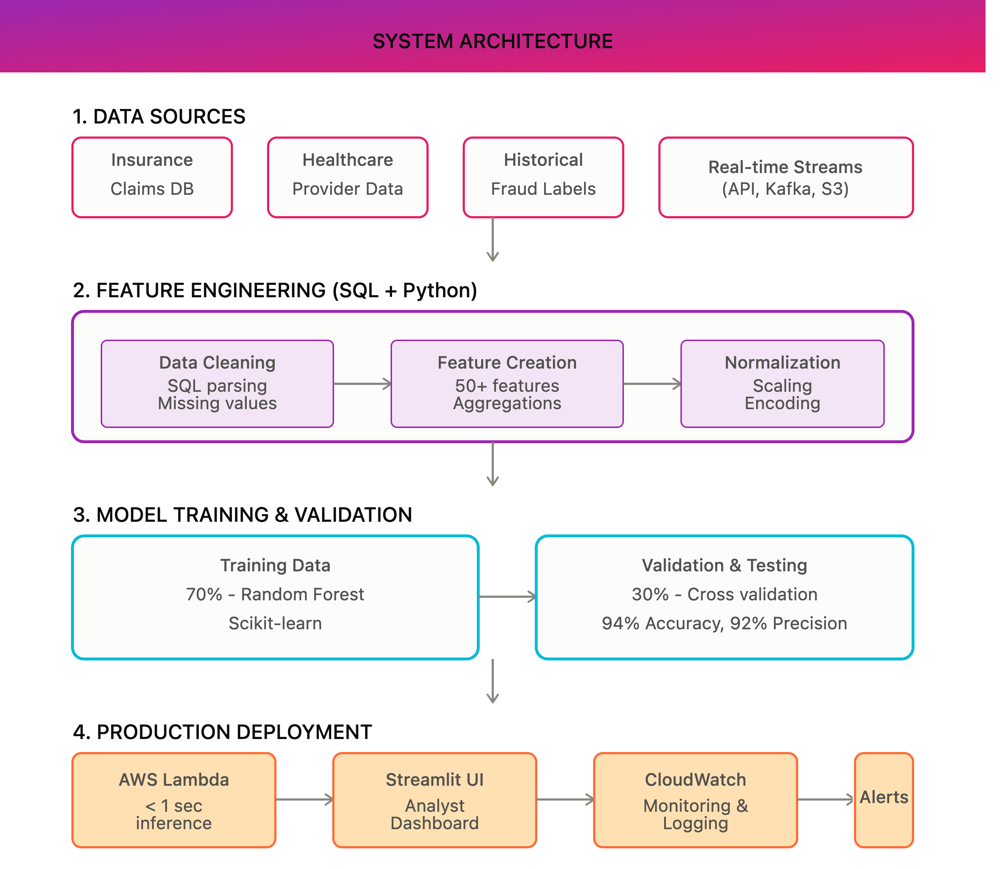

# Healthcare Fraud Detection — Hybrid Rules + ML Claims Risk Scoring

[](https://github.com/kamjula/healthcare-fraud-detection/actions/workflows/ci.yml) [](LICENSE)

A portfolio implementation of a **hybrid rule-based and machine-learning workflow** for prioritizing potentially suspicious healthcare claims for human review.

The repository uses **synthetic claims only**. It does not contain PHI and does not claim production fraud-detection accuracy.



## What is actually implemented

- Synthetic claims generator with injected suspicious patterns
- Feature engineering at claim/provider level
- Configurable YAML fraud rules
- XGBoost classifier training and persisted model artifact
- Hybrid score combining ML probability and rule score
- Claim-level investigation CLI explaining why a record was flagged
- PostgreSQL schema and analytical SQL
- Dockerfile and one-command demo script
- pytest test suite

## Detection flow

```text
Synthetic claims
      │
      v
Validation / preparation
      │
      v
Feature engineering
      │
      ├──────────────> Configurable rules
      │
      └──────────────> XGBoost classifier
                         │
                         v
              Hybrid risk score
                         │
                         v
              Human-review shortlist
```

## Risk scoring

```text
final_risk_score = ml_weight * ml_probability
                 + rule_weight * rule_score
```

Thresholds and weights are stored in `config/fraud_rules.yaml`, so scoring behavior can be changed without editing model code.

## Repository layout

```text
healthcare-fraud-detection/
├── config/fraud_rules.yaml       # rule thresholds and scoring weights
├── scripts/run_demo.sh           # one-command demo
├── sql/                          # PostgreSQL schema, data load, and the rules in SQL
├── src/
│   ├── config.py                 # paths and rules loader
│   ├── data/
│   │   ├── generate_synthetic.py # synthetic claims with injected fraud patterns
│   │   └── prepare.py            # validation and cleaning
│   ├── features/engineer.py      # claim- and provider-level features
│   ├── rules/engine.py           # rule-based detection
│   ├── models/
│   │   ├── train.py              # XGBoost training
│   │   └── score.py              # ML probability + hybrid score
│   ├── pipeline.py               # end-to-end CLI
│   └── investigate.py            # single-claim drill-down CLI
├── tests/                        # pytest unit tests
├── images/system-architecture.png
├── Dockerfile
└── requirements.txt
```

`data/` and `models/` are created when the demo runs; the generated CSVs and model file are not committed.

## Run the demo

```bash
git clone https://github.com/kamjula/healthcare-fraud-detection.git
cd healthcare-fraud-detection

python -m venv .venv
source .venv/bin/activate
pip install -r requirements.txt

bash scripts/run_demo.sh
```

Or run individual stages:

```bash
python -m src.data.generate_synthetic     # writes data/sample_claims.csv
python -m src.pipeline --train            # trains the model, writes data/scored_claims.csv
python -m src.investigate --claim-id CLM00001234
```

Run with Docker:

```bash
docker build -t fraud-detection .
docker run --rm -v "$(pwd)/data:/app/data" fraud-detection
```

Run tests:

```bash
python -m pytest -q
```

## Using your own data

Replace the generator output with a CSV that has these columns:

```text
claim_id, provider_id, npi, provider_specialty, patient_id,
cpt_code, icd10_code, claim_date, units, billed_amount, paid_amount
```

An `is_fraud` label is only needed to train the model; the rule engine runs without it.

## Important evaluation note

The synthetic generator intentionally creates separable fraud patterns, so the model can report a near-perfect ROC-AUC on that generated dataset.

That number is **not presented as real-world model performance**. On real claims, labels are noisy and scarce, data leakage is a serious risk, and proper temporal/external validation would be required.

## Stack

Python · Pandas · NumPy · scikit-learn · XGBoost · PyYAML · PostgreSQL · Docker · pytest

## Scope and limitations

- Synthetic data only
- Statistical/rule/model outputs are prioritization signals, not proof of fraud
- No clinical or payment decision should be made from this portfolio system
- Real claims would require HIPAA controls, access restrictions, audit logging, and a stronger validation strategy

## Author

**Sravani Kamjula** · AI/ML Engineer  
[LinkedIn](https://www.linkedin.com/in/sravani-kamjula/) · [Portfolio](https://sravaniportfoli.netlify.app/)
